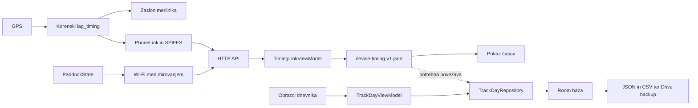
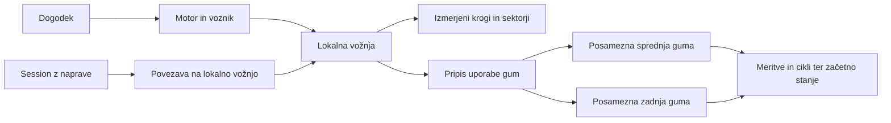

# Pregled projekta in navodila za Astro in Sol

Datum pregleda: 13. november 2026. Korenski repozitorij ob pregledu: `5385ecf`; Android podmodul `race`: `1737b32`.

Aplikacija že vsebuje programsko povezavo z merilnikom prek Wi-Fi in lokalni prikaz prenesenih krogov s tremi sektorji. Preneseni časi so v ločenem arhivu in še niso povezani z vožnjami v dnevniku, motorjem, voznikom ali gumami. Glavna naslednja nadgradnja je povezati te podatke, poenostaviti upravljanje ter dokončati evidenco posameznih gum.

Ta predaja temelji na pregledu izvorne kode. Delovanje prenosa na fizičnem telefonu in merilniku zahteva ločen preizkus. V tem posegu se izvedbena koda ni spreminjala.

## Cilj uporabnika

Uporabnik želi aplikacijo, ki sprejema čase iz lastnega merilnika, jih poveže z dnevnikom voženj in omogoča hitro delo na dirkališču. Meniji morajo biti preprostejši in intuitivni. V nastavitvah želi označiti, katere funkcije, kartice in polja naj se prikazujejo.

Za vsako fizično gumo želi s kamero prebrati njeno črtno kodo oziroma ji dodeliti lastno oznako, voditi kroge in toplotne cikle, označiti novo ali rabljeno stanje ter zapisovati globino profila. Ob prvem vnosu morata biti podprta zmes in letnik izdelave. Že izvedene funkcije je treba nadgraditi in ohraniti obstoječe podatke.

Izraz »aparat« je v tej predaji razumljen kot kamera telefona. Zunanji samostojni čitalnik ni potrjena zahteva.

## Struktura projekta in povezave

```text
lap timer/
  platformio.ini          Aktivni ESP32 firmware in particijska tabela
  src/main.cpp           Povezava GPS, timinga, prikaza in PhoneLink
  src/lap_timing.h        Časi krogov in sektorjev
  src/phone_link.h        Notranji arhiv in HTTP API za telefon
  src/paddock_state.h     Mirovanje, odhod in pogoji za Wi-Fi
  src/device_settings.h  Nastavitve fizičnega merilnika
  src/analysis_logger.h  SD beleženje
  include/               Zaslon in konfiguracija prog
  tracks/                Izvor geometrije proge
  tools/                 Terminalska in lokalna preverjanja
  docs/                  Dokumentacija aktivnega merilnika
  race/                  Android projekt kot Git podmodul
    app/                 Kotlin, Compose, Material 3, Room
    timing/              Starejši ločen firmware
  cad/                   Ohišje in 3D modeli
  hardware/              Dokumentacija prototipa elektronike
```

**Aktivni firmware je v korenu.** Za trenutno povezavo s telefonom se uporablja korenski `platformio.ini` in `src/main.cpp`. Firmware v `race/timing` ima drugačno arhitekturo in priklop ter ni prava osnova za ta poseg. To potrjuje [vodič za povezavo](phone_connection.md). Starejši [race/user.md](../race/user.md) in [race/README.md](../race/README.md) sta uporabna za Android strukturo, opis firmwarea in nekateri statusi pa so zastareli.

| Področje | Glavne datoteke |
| --- | --- |
| Vstop v aplikacijo | [MainActivity.kt](../race/app/src/main/java/com/example/trackdaylog/MainActivity.kt), [TrackDayLogApplication.kt](../race/app/src/main/java/com/example/trackdaylog/TrackDayLogApplication.kt) |
| Navigacija | [AppNavigation.kt](../race/app/src/main/java/com/example/trackdaylog/navigation/AppNavigation.kt) |
| Domača stran in skupni gradniki | [HomeScreen.kt](../race/app/src/main/java/com/example/trackdaylog/ui/screens/HomeScreen.kt), [AppComponents.kt](../race/app/src/main/java/com/example/trackdaylog/ui/components/AppComponents.kt) |
| Povezava in prikaz časov | [TimingLinkViewModel.kt](../race/app/src/main/java/com/example/trackdaylog/timing/TimingLinkViewModel.kt), [TimingLinkScreen.kt](../race/app/src/main/java/com/example/trackdaylog/ui/screens/TimingLinkScreen.kt) |
| Obrazci dnevnika | [TrackDayScreens.kt](../race/app/src/main/java/com/example/trackdaylog/ui/screens/TrackDayScreens.kt), [SessionScreens.kt](../race/app/src/main/java/com/example/trackdaylog/ui/screens/SessionScreens.kt) |
| Gume in fotografije | [TyreScreens.kt](../race/app/src/main/java/com/example/trackdaylog/ui/screens/TyreScreens.kt), tudi `SessionScreens.kt` |
| Stanje aplikacije | [TrackDayViewModel.kt](../race/app/src/main/java/com/example/trackdaylog/viewmodel/TrackDayViewModel.kt) |
| Poslovna pravila | [TrackDayRepository.kt](../race/app/src/main/java/com/example/trackdaylog/data/repository/TrackDayRepository.kt), [RepositoryModels.kt](../race/app/src/main/java/com/example/trackdaylog/data/repository/RepositoryModels.kt) |
| Podatkovni model | [Entities.kt](../race/app/src/main/java/com/example/trackdaylog/data/entity/Entities.kt), [Daos.kt](../race/app/src/main/java/com/example/trackdaylog/data/dao/Daos.kt), [AppDatabase.kt](../race/app/src/main/java/com/example/trackdaylog/data/database/AppDatabase.kt) |
| Izvoz in obnova | [ExportSnapshot.kt](../race/app/src/main/java/com/example/trackdaylog/data/repository/ExportSnapshot.kt), [ExportManager.kt](../race/app/src/main/java/com/example/trackdaylog/export/ExportManager.kt) |
| Drive backup | [DriveBackupManager.kt](../race/app/src/main/java/com/example/trackdaylog/backup/DriveBackupManager.kt), [BackupSyncScreen.kt](../race/app/src/main/java/com/example/trackdaylog/ui/screens/BackupSyncScreen.kt) |



Poslovni model dnevnika je `TrackEvent → EventParticipant → Session`: dogodek vsebuje udeležence, udeleženec določa motor in voznika, vožnje pripadajo udeležencu. Nekatera polja z imenom `trackDayId` danes dejansko vsebujejo `eventParticipantId`. Pri spremembah je treba preveriti pomen konkretnega polja, saj aplikacija ohranja tudi stare tabele in migracije.

## Ali je aplikacija že povezana z merilnikom

**Da, povezava je implementirana v kodi obeh strani. Trenutna fizična povezava in uspešen prenos na tej opremi nista potrjena.**

1. `src/main.cpp` ustvari `PhoneLink`, kliče `begin()`, pošilja GPS opazovanja, predaja dogodke zaključenih krogov in kliče `poll()`.
2. `src/phone_link.h` shrani veljavne zaključene kroge REAL v SPIFFS, neodvisno od vključenega SD beleženja. Razvojni TEST podatki se ne prenašajo.
3. Kakovosten GPS in 30 sekund mirovanja znotraj 2 m sprožita zaščiteno omrežje `LapTimer-…`. Odhod nad 5 km/h izključi Wi-Fi. Brez ustreznih GPS meritev to ni stalno dostopna dostopna točka.
4. Merilnik ponudi `GET http://192.168.4.1/api/v1/sessions` in `GET http://192.168.4.1/api/v1/laps?id=…`. Protokol se identificira z verzijo 1 v indeksu sessionov.
5. Androidov `TimingLinkViewModel` zahteva ustrezno Wi-Fi omrežje, usmeri samo te HTTP zahteve nanj in na odprtem zaslonu preverja podatke vsakih 5 sekund. Ob zaprtju zaslona ali odhodu aplikacije v ozadje povezavo sprosti.
6. Prenesene vožnje združuje po ključu `device:id` in jih z `AtomicFile` shranjuje v `device-timing-v1.json`. Ponovni prenos iste vožnje z enakim številom krogov preskoči. Shranjeni časi so vidni brez povezave.

Na zaslonu »Časi z naprave« so izbira dneva, izbira vožnje, krogi, najboljši čas in trije sektorji. To je prenos po vožnji med mirovanjem; trenutni protokol ne prenaša žive telemetrije med vožnjo.

**Manjkajoča povezava:** `DeviceSession` nima povezave na Room `SessionEntity`, udeleženca ali gume. Arhiv naprave ni v obstoječem JSON/CSV izvozu in Drive backupu. Ročna vožnja vsebuje povzetek `bestLapTime` in `laps`, nima pa Room tabele za posamezne izmerjene kroge in sektorje.

Za prvo povezavo je treba naložiti korenski firmware z ustrezno particijsko tabelo, na USB prebrati SSID in geslo, namestiti aplikacijo ter opraviti postopek iz [phone_connection.md](phone_connection.md). To, da se obe strani prevedeta, ne dokazuje, da sta trenutno nameščeni na napravah.

## Kaj je že implementirano

| Zahteva | Stanje po kodi | Potrebna dopolnitev |
| --- | --- | --- |
| Sprejem časov iz merilnika | Implementiran Wi-Fi/HTTP prenos, lokalni arhiv, krogi in 3 sektorji | Preizkus na napravah in povezava z dnevnikom |
| Dnevnik dogodkov, motorjev in voznikov | Implementiran | Ohraniti model več udeležencev |
| Hitri vnos vožnje, tlaki in občutki | Implementiran; napredna polja so deloma že zložljiva | Poenostaviti pot in prilagoditi vidnost |
| Enotna glavna navigacija | `NavHost`, vrhnja vrstica in gumbi na domači strani | Jasne glavne destinacije in manj enakovrednih gumbov |
| Settings za prikaz modulov in polj | Ni implementirano | Trajno shranjene uporabniške nastavitve |
| Jezik in aktivni izbor | Jezik SL/EN je v `SharedPreferences`; aktivni motor/voznik sta v `MutableStateFlow` | Ohraniti nastavitve jezika; določiti trajnost aktivnega izbora |
| Inventar gum | Guma pripada motorju; spredaj/zadaj; `MOUNTED`, `STORED`, `USED_UP` | Ločiti dodajanje v zalogo od montaže |
| Znamka, model in dimenzija | Implementirano | Odpraviti morebitno podvajanje `size` in `dimension` brez izgube podatkov |
| Zmes | `compound` v entiteti in obrazcih | Ohraniti, izboljšati prvi vnos in validacijo |
| Nova ali rabljena guma | `isNewAtMounting`, začetni km in stanje v 10-odstotnih korakih | Začetni krogi in cikli ter merjen profil |
| Letnik | Obstaja neobdelano besedilo `dot` | Izrecen letnik oziroma teden/leto, preverjanje in možnost »neznano« |
| Črtna koda | Ni polja, čitalnika ali povezane knjižnice | Branje s kamero/slike, iskanje, dodelitev in obravnava dvojnikov |
| Kilometri gume | Začetni/trenutni km in popravljanje po spremembi km vožnje | Natančna dodelitev konkretni gumi ob menjavah |
| Število krogov posamezne gume | Ni izvedeno | Povezava voženj/krogov z gumo in začetno stanje rabljene gume |
| Toplotni cikli | Prikaz obstaja, izračun je približek | Samostojen model in začetno stanje ter popravki |
| Globina profila v mm | Ni izvedeno | Meritve levo/sredina/desno skozi čas |
| Fotografije gum | Kamera prek `TakePicture`, shranjeni URI in galerija | Fotografija še ne pomeni branja črtne kode |
| Menjava gum | Evidenca montaže/demontaže, tudi pred/po vožnji | Preveriti zgodovinsko pripisovanje uporabe |
| Izvoz in backup | JSON, CSV ter ročni Drive upload/list/download/restore so napisani | Razširitev za nove podatke in preverjanje dejanske obnove |

`race/README.md` še označuje Drive kot drugo fazo, čeprav je izvedbena koda že prisotna. Pri oceni stanja imajo konkretne implementacije prednost pred starejšim opisom.

## Ugotovitve ki jih mora Astra posebej preveriti

### Toplotni cikli trenutno niso samostojna evidenca

`TrackDayRepository.getTyreUsageSummary()` prebere `TyreWearEntity`, prešteje različne `sessionId` in nastavi `heatCycles = sessionCount`. Vožnja brez ocene obrabe zato ni zajeta; zapis obrabe pa sam ne potrjuje segretja in ohladitve. Tega števila se pri migraciji ne sme brez oznake pretvoriti v potrjene toplotne cikle.

### Menjava gum lahko izkrivi pripisovanje uporabe

`TrackDayTyreEntity` ima edinstveno kombinacijo `trackDayId, position`, DAO pa uporablja `OnConflictStrategy.REPLACE`. `changeTyreForSession()` zapisuje novo gumo v ta dnevni snapshot. `saveSession()` ob spremembi km pokliče `addKmToTrackDayTyres()`, ki uporabi trenutno vsebino teh snapshotov. Iz tega sledi tveganje, da popravek stare vožnje obremeni pozneje montirano gumo. Preizkusiti je treba tudi izgubo prejšnjega dnevnega snapshota ob menjavi.

Rešitev mora shraniti identiteto sprednje in zadnje gume za konkretno vožnjo oziroma razpon krogov. Začetni in končni podatki dneva ter dogodki montaže ostanejo uporabni za zgodovino, ne zadostujejo pa za natančen izračun porabe.

### Ura začetka ni absolutni UTC čas

Firmware v `Header.startUtcMs` zapiše `fix.utcMs`. V `main.cpp` je to število milisekund od UTC polnoči, ne Unix epoch. Android ga trenutno samo shrani kot `Long`. Astra mora pred samodejnim ujemanjem dogodkov določiti pomen `day`, lokalnega UTC odmika in prehoda čez polnoč. Imena polja ne sme obravnavati kot dokaz, da gre za absolutni timestamp. Morebitna sprememba protokola ali binarne glave zahteva združljivost obstoječih arhivov.

### Povzetki prenosa niso dovolj za vse popravke

Android preskoči prenos, ko se ujema število krogov. Astra naj preveri, ali protokol zagotavlja nespremenljivost teh krogov, ter obnašanje ob poškodovanem zapisu, napolnjenem pomnilniku, ponovnem zagonu in izbrisu arhiva. Novi most v Room mora preprečiti podvojitev tudi ob prekinitvi med zapisovanjem ali ponovnem uvozu.

### Backup fotografij je ločen problem

`ExportManager` zapisuje `imageUri`, Drive manager pa naloži JSON datoteko. S tem slikovne datoteke niso vključene v paket. Obnova na drug telefon zato potrebuje kopiranje slik in preslikavo URI-jev ali jasno omejitev, da backup vsebuje samo podatke. Enako je treba izrecno obravnavati današnji ločeni arhiv časov in nove nastavitve prikaza.

## Predlog poenostavitve aplikacije

To je izhodišče za Astrino presojo. Predlagane glavne destinacije so **Domov, Vožnje, Gume, Garaža in Nastavitve**. Androidove smernice priporočajo 3 do 5 enakovrednih destinacij v glavni navigacijski vrstici, eno poudarjeno glavno dejanje ter manj pogosta dejanja v dodatnem meniju: [Android layouts and navigation patterns](https://developer.android.com/design/ui/mobile/guides/layout-and-content/layout-and-nav-patterns).

Domov naj pokaže aktivni dogodek, motor/voznika, stanje merilnika in eno glavno dejanje, na primer »Nadaljuj dan«. Pod Vožnje sodijo dogodek, udeleženec, ročni vnosi in preneseni časi. Gume vsebujejo inventar, skeniranje in zgodovino posamezne gume. Garaža združi motorje, voznike, servise in presete. Izvoz, backup ter razvojni testni podatki sodijo v ustrezne nastavitve ali dodatni meni.

Predlagana vsebina **Nastavitve → Prikaz**:

- izbira vidnih modulov, na primer stroški, gorivo, servis, vzmetenje, zobniki, fotografije in primerjava;
- izbira kartic na domači strani in v podrobnostih vožnje;
- izbira dodatnih polj hitrega vnosa, na primer vreme, temperature in podrobnejši občutki;
- prednastavitvi »Osnovno« in »Napredno«, nato možnost lastnega izbora;
- dejanje »Povrni privzeti prikaz« in vedno dosegljive Nastavitve.

Skritje spremeni prikaz in obrazce, ohrani pa zapise in izračune. Vklop/izklop povezovanja ali zbiranja podatkov mora biti ločena nastavitev, če bo sploh dodana. Sprememba vidnosti se ohrani po ponovnem zagonu, velja tudi za povezane hitre akcije in ne pusti slepih povezav. Astra naj določi obravnavo neposrednih povezav v skrit modul in obveznih polj. Izbira motorja/voznika ter pogoji za pravilen zapis morajo ostati razumljivi.

Uporabiti je treba obstoječi Compose/Material 3 in obstoječe gradnike. Predelava v drug UI okvir ni potrebna. Za UX prevzem naj se preverijo mali zaslon, večja pisava, tipkovnica, ohranitev osnutka ob rotaciji in jasna pot nazaj.

## Zahteve za evidenco gum

### Identiteta in črtna koda

En zapis mora predstavljati eno fizično gumo skozi njeno življenjsko dobo. Isti model v isti dimenziji lahko obstaja večkrat. Notranji ID gume, proizvajalčeva črtna koda in DOT so ločeni podatki.

Predlagani tok je **Gume → Skeniraj → odpri obstoječo gumo ali dodaj novo**. Podpreti mora neposredno skeniranje s kamero, branje posnete/izbrane slike in ročni vnos. Če se zazna več kod, uporabnik izbere pravo. Neuspešno branje, zavrnitev kamere ali preklic ne smejo ustvariti prazne gume.

Shraniti je treba izvorno vrednost kot besedilo, format kode in način vnosa. Ohranijo se začetne ničle in velikost črk, dokler ni znano pravilo konkretnega proizvajalca. Pri znani individualni kodi ponovni scan odpre isti zapis. Če vzorec vsebuje samo oznako izdelka, iste vrednosti ni dovoljeno samodejno razglasiti za identiteto posamezne gume; potreben je ločen interni ID in po potrebi lastna izpisljiva oznaka. Astra naj določi način generiranja take kode in obliko nalepke, če jo uporabnik potrebuje.

Format, edinstvenost in vsebino dejanskih kod je treba potrditi z vzorci uporabnikovih gum. Iz poljubne kode ni mogoče kar predpostaviti zmesi, dimenzije ali letnika. Samodejno izpolnjevanje je dovoljeno le za preverjeno obliko kode ali znan katalog; sicer se podatki vnesejo ročno.

Za uporabo brez interneta je smiselna kandidatka knjižnica z modelom, vključenim v aplikacijo. Google dokumentira, da je bundled ML Kit model dosegljiv takoj, unbundled pa se mora prej prenesti. Astra naj preveri ustrezno rešitev in licence ter poda konkretne odvisnosti, dovoljenja in življenjski cikel kamere: [ML Kit barcode scanning for Android](https://developers.google.com/ml-kit/vision/barcode-scanning/android). Sam čitalnik kode ne zagotovi kataloga podatkov o gumi.

### Prvi vnos in rabljena guma

Obrazec naj vsebuje znamko, model, dimenzijo, spredaj/zadaj, zmes, proizvodni letnik oziroma teden/leto, DOT po potrebi, nova/rabljena, začetno uporabo, profil in opombo. Zmes že obstaja in je treba ohraniti vse njene sedanje vnose.

Pri prepoznavnem datumu DOT zadnje štiri številke pomenijo teden in leto izdelave. To velja za ustrezno oznako na gumi in ne za poljubno črtno kodo: [NHTSA TireWise](https://www.nhtsa.gov/vehicle-safety/tires). Datum naj uporabnik potrdi; letnik mora biti mogoče vnesti tudi ročno ali označiti kot neznan. Staremu prostemu besedilu DOT se ne sme na silo pripisati izmišljenega datuma.

Za rabljeno gumo morajo biti začetni kilometri, krogi in toplotni cikli ločeni od uporabe, zabeležene v aplikaciji. Neznana pretekla uporaba je »neznano«, ne samodejno 0. Stanje v odstotkih je subjektivna ocena in ne nadomesti izmerjene globine.

**Dodaj v inventar** in **Montiraj** morata biti ločeni dejanji. Sedanja pot `mountNewTyre()` ob vnosu avtomatično zamenja aktivno gumo. Popis rezervne gume tega ne sme storiti. Ob ponovni montaži se uporabi isti zapis in ohrani zgodovina.

### Globina profila

Meritve morajo biti zgodovinski zapisi z datumom in po potrebi povezavo na vožnjo. Predlagana mesta so levo, sredina in desno v mm. Podpreti je treba decimalno vejico, prazno/neznano vrednost ter veljavno vrednost 0, brez negativnih števil. Za slick naj obstaja »ni profila« in po potrebi druga ustrezna meritev obrabe; ne vpisovati lažnih 0 mm samo zato, ker profila ni mogoče meriti na enak način.

### Krogi in povezava z vožnjo

Vsaka vožnja mora imeti pripis konkretne sprednje in zadnje gume. Izmerjeni krogi in sektorji se shranijo kot številčne vrednosti v ms, oblikovanje časa ostane v UI. Ponovni prenos in urejanje iste vožnje ne smeta ponovno prišteti že upoštevanih krogov. Popravek pripisa mora odstraniti star prispevek in dodati novega v transakciji.

Merilnik trenutno pošilja samo veljavne zaključene merjene kroge. To ni nujno vsa uporaba gume, na primer izhodni, vhodni ali zavržen krog. Astra mora ločiti »zabeleženi merjeni krogi« od morebitnega ročnega skupnega števila in določiti pravilo popravkov. Manjkajočih kilometrov ne sme izračunavati iz števila krogov brez znane dolžine proge in jasne oznake ocene.

Menjave pred in po vožnji morajo dati pravilen pripis. Če želi uporabnik menjavo znotraj iste vožnje, je potreben razpon krogov oziroma razdelitev vožnje; trenutni API ne sporoča trenutka menjave gume. Predlog mora jasno določiti, kaj je v prvi izvedbi podprto.

### Toplotni cikli

Toplotni cikel potrebuje lastno evidenco, začetno stanje in sledljive popravke. Aplikacija trenutno nima podatkov, ki bi dokazovali segrevanje in ohladitev. Število voženj in število ciklov se zato ne smeta enačiti.

Predlog za prvo izvedbo je ročni potrjeni cikel z možnostjo, da aplikacija po vožnji ponudi predlog. Predlog ne šteje kot potrjen dogodek. Astra mora določiti pravilo za zaporedni vožnji brez ohladitve in ravnanje z grelci. Samodejna temperaturna zaznava je morebitna poznejša funkcija, odvisna od dejanskega vira podatkov.

## Povezava časov z dnevnikom

Predlagani tok je **prenesi → predlagaj dogodek/udeleženca → uporabnik potrdi → poveži vožnjo in gume**. Datum in ime proge lahko pomagata pri predlogu, ne določita pa voznika ali motorja. En telefon lahko upravlja več udeležencev.

Astra naj določi trajno shranjevanje prenesenih sessionov in krogov, enolične ključe, povezavo z lokalno vožnjo, zaščito pred dvojnim povezovanjem ter možnost odvezave in popravka. Preveri naj, ali se obstoječi JSON arhiv prenese v Room ali ostane izvorni arhiv z dodatnim mostom. V obeh primerih morajo obstoječi preneseni časi preživeti nadgradnjo in biti vključeni v dogovorjeni backup.



## Prednostni vrstni red za izvedbo

P0 pomeni preverjanje in odločitve, brez katerih je nadaljnja izvedba nezanesljiva. P1 zajema uporabnikove glavne cilje. P2 so dopolnitve po delujočem osnovnem toku. Testiranje in migracije so del vsake naloge.

| Naloga | Prioriteta | Rezultat in odvisnosti |
| --- | --- | --- |
| T01 Potrdi izhodišče in prenos | P0 | Build obeh delov, preizkus API in telefona; dokumentiran rezultat dejanske povezave |
| T02 Določi podatkovna pravila | P0 | Pomen časa, identiteta gum, pripis voženj, začetna uporaba in pravilo ciklov; preveri zgornja tveganja |
| T03 Poenostavi navigacijo | P1 | Glavne destinacije, krajša domača stran, jasen aktivni udeleženec; po T02 za skladno poimenovanje |
| T04 Dodaj nastavitve prikaza | P1 | Trajni vklopi modulov, kartic in dodatnih polj, privzeti profili, ponastavitev; uporablja T03 |
| T05 Razširi podatkovni model | P1 | Varne migracije za individualne kode, profil, začetno uporabo, cikle, pripis gum in izmerjene kroge; po T02 |
| T06 Poveži prenesene čase z dnevnikom | P1 | Potrditev dogodka/udeleženca, krogi in sektorji v vožnji, brez podvajanja; po T01 in T05 |
| T07 Dodaj skeniranje in popis gum | P1 | Kamera/slika/ročni vnos, najdi ali ustvari, inventar ločen od montaže, zmes in letnik; po T05 |
| T08 Dokončaj uporabo in obrabo gum | P1 | Krogi, potrjeni cikli, rabljena začetna stanja, zgodovina profila in pravilen popravek po menjavi; po T05 do T07 |
| T09 Razširi izvoz in obnovo | P1 | Novi podatki, povezave, nastavitve in dogovorjeni obseg slik se ohranijo pri obnovi; shemo izvoza načrtuj že pri T05 |
| T10 Preveri celoten tok | P1 | Nadgradnja obstoječe baze, offline uporaba, ponovni prenos, več motorjev, menjava gum in obnova; pred izdajo |
| T11 Dopolni analitiko in udobje | P2 | Filtri, dodatni prikazi obrabe, urejanje vrstnega reda kartic, širši katalog kod, če je potreben |

Minimalni uporaben rezultat obsega T01 do T10. Osnovni pregled gum, preglednost menijev in zanesljiv prenos imajo prednost pred dodatno analitiko. BLE TPMS, izboljšave IMU, novo ohišje in prenova elektronike niso odvisnosti teh ciljev.

## Kaj mora Astra vrniti za Sol

Astra naj najprej preveri ugotovitve v konkretnih datotekah in nato vrne izvedbeni načrt. Pri vsaki nalogi mora navesti:

1. ID naloge, uporabniški rezultat, prioriteto, odvisnosti in oceno velikosti S/M/L.
2. Točne datoteke in funkcije, ki se spremenijo; nove datoteke naj jasno označi kot predlog.
3. Podatkovne spremembe, ključe, indekse, transakcije in pravila proti podvajanju.
4. Migracijo iz današnje Room verzije 4, obravnavo starega JSON arhiva in združljivost izvoza/obnove.
5. Konkreten UI tok in besedila v SL/EN, privzeto vidnost ter vpliv nastavitev.
6. Merila sprejema s primeri vhodnih podatkov in pričakovanih rezultatov.
7. Ustrezne avtomatske in ročne preizkuse ter ukaze za preverjanje.

Pred izvedbo naj razreši le odločitve, ki jih ni mogoče varno sklepati: vzorci dejanskih kod, pomen cikla v uporabnikovi praksi, potreba po menjavi gum znotraj iste vožnje in morebitna uporaba iste gume na več motorjih. Ostale odločitve naj utemeljeno predlaga. Začasna neznana vrednost mora ostati jasno neznana.

Sol naj dobi naloge v majhnih zaključenih korakih z migracijami in preverjanji v istem koraku. Ohraniti mora obstoječe ročne vožnje, oba jezika, delo brez interneta in več udeležencev. Spremembam podatkov ne sme dodati destruktivne migracije. Firmware naj spreminja le, če je ugotovljena konkretna potreba; spremembe arhiva/protokola naj imajo načrt združljivosti.

## Merila za končni prevzem

- Telefon prenese vsaj dve vožnji s krogi in tremi sektorji, ponovni prenos pa ne podvoji podatkov. Po ponovnem zagonu telefona so časi vidni brez povezave.
- Uporabnik preneseno vožnjo poveže s pravim dogodkom, motorjem in voznikom. Pri več kandidatih aplikacija ne ugiba potiho.
- V Nastavitvah skrije na primer stroške, gorivo in vzmetenje. Izbor ostane po zagonu, podatki pa se po ponovnem prikazu ohranijo.
- Dve fizični gumi iste znamke/modela/dimenzije ostaneta dva zapisa. Ponovni scan individualne kode odpre isti zapis. Produktna koda ne združi dveh gum.
- Rabljeno gumo je mogoče vnesti z zmesjo, letnikom, znano ali neznano preteklo uporabo ter meritvami profila. Vnos v zalogo ne zamenja montirane gume.
- Primer: guma A je uporabljena na prvi vožnji, B na drugi. Popravek prve vožnje spremeni uporabo A. B ostane nespremenjena. Ponovni uvoz ne poveča števcev.
- Obstoječa ocena obrabe sama ne ustvari potrjenega toplotnega cikla. Dve vožnji brez ohladitve se ne pretvorita avtomatično v dva potrjena cikla.
- Profil ohrani več meritev skozi čas in razlikuje 0, neznano ter »ni profila«.
- Nadgradnja današnje baze in obnova starega ter novega izvoza ohranita podatke in povezave. Preskus obnove slik preveri dejanske datoteke, če so vključene v obseg.
- Zavrnjena dovoljenja, nedostopna kamera, napačno geslo, izguba omrežja in napaka pomnilnika pokažejo uporabno sporočilo ter ohranijo že shranjene podatke.

## Preverjanja ob tem pregledu

`tools/test_paddock.cmd`: **16 uspešnih preverjanj** mirovanja, izgube GPS, odhoda, preliva števca časa in prekinitve nedokončanega kroga. To ni preizkus HTTP prenosa ali kamere.

Korenski `.venv/Scripts/platformio.exe run -e esp32dev`: **uspešno**. Preverjeni build porabi 78.116 B statičnega RAM in 1.388.450 B flash za aplikacijo z razpoložljivimi 3.145.728 B. Starejše številke porabe v korenskem README ne opisujejo tega trenutnega Wi-Fi builda.

`adb devices`: prazen seznam. `python -m serial.tools.list_ports`: ni najdenih vrat. Dejanski prenos in namestitev firmwarea/aplikacije zato v tem pregledu nista potrjena. Firmware ni bil naložen, SD ni bila formatirana in NVS ni bil spreminjan.

Android `:app:assembleDebug --offline --no-daemon`: **ni uspešno dokončan**. Prvi poskus je izpisal napako dostopa do Kotlinove začasne datoteke in obstal pri `:app:kaptDebugKotlin`. Ponovitev z `-Pkotlin.compiler.execution.strategy=in-process --stacktrace` je potrdila `AccessDeniedException` za SDK datoteki `build-tools/36.0.0/core-lambda-stubs.jar` in `platforms/android-37.0/android.jar`, ki sta zunaj delovne mape. Polnega Android builda zato ni mogoče označiti kot potrjenega. Dnevnik ponovitve je v lokalni, Git-ignorirani datoteki `.pio/astra-android-build.log`.

Za ponovitev v ustreznem okolju iz korena projekta:

```powershell
.\tools\test_paddock.cmd
.\.venv\Scripts\platformio.exe run -e esp32dev
Push-Location race
$env:JAVA_HOME = 'C:\Program Files\Android\Android Studio\jbr'
.\gradlew.bat --offline --no-daemon '-Pkotlin.compiler.execution.strategy=in-process' :app:assembleDebug
Pop-Location
```

Android projekt trenutno nima map `app/src/test` ali `app/src/androidTest`. Astra naj predpiše predvsem teste migracij, pripisa gum, ponovnega uvoza, števcev in obnove; samo uspešen build teh pravil ne preveri. `--offline` pri zgornjem ukazu predpostavlja že lokalno dostopne odvisnosti.

## Besedilo za predajo Astri

> Preglej projekt na podlagi tega dokumenta in preveri ugotovitve neposredno v kodi. Cilj je aplikacija, ki zanesljivo prevzame čase iz obstoječega ESP32 merilnika, jih poveže z dnevnikom voženj ter vodi posamezne gume. Poenostavi predlog navigacije in določi trajne nastavitve za prikaz modulov, kartic in polj. Za gume pripravi izvedbo črtnih kod s kamere in fotografije, inventarja, zmesi, letnika, rabljene začetne uporabe, krogov, toplotnih ciklov in meritev profila. Posebej preveri današnji izračun heatCycles, pripis gum ob menjavi, pomen startUtcMs in ločenost arhiva časov od Room ter backupa. Vrni konkretna navodila za Sol po nalogah T01 do T10: vrstni red, datoteke/funkcije, podatkovni model, migracije iz Room v4, UI tokove, odvisnosti, merila sprejema in preizkuse. Jasno loči potrjeno stanje kode, predloge in odprta vprašanja. Ohraniti je treba podatke, SL/EN, več voznikov/motorjev in offline delovanje. Najprej vrni načrt izvedbe; implementacijo bo po njem opravil Sol.
