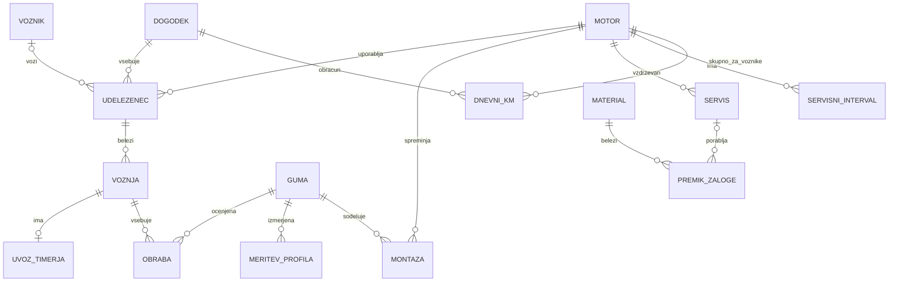

# Trenutno stanje aplikacije

Datum pregleda: **25. 11. 2026**. Dokument opisuje trenutno kodo v tej delovni mapi, vključno z lokalnimi spremembami, ki še niso nujno potrjene v Git. To ni zagotovilo, da je ista različica že nameščena na telefonu.

**Dopolnitev 26. 11. 2026:** poljem za ročni vnos je dodana majhna ikona **ⓘ** ob desnem robu. Dotik odpre kratek oblaček z razlago pomena, enote ali formata; dotik zunaj oblačka oziroma Nazaj ga zapre. Navodila so v slovenščini in angleščini ter pokrivajo tudi geslo, predloge pri gumah in meritve profila. Oko za prikaz gesla ostane ločen gumb. Obstoječa polja in shema baze se zaradi pomoči ne spreminjajo. Pregled predlaganih izboljšav je v [optimizacija aplikacije 2026](optimizacija%20aplikacije%202026.md).

Android aplikacija je v mapi **`race/`**. Korenski `src/main.cpp` pripada pravemu merilniku ESP32; ločen projekt **`test timer/`** simulira merilnik brez priklopljenih senzorjev. Funkcije strojne programske opreme niso samodejno tudi funkcije Android aplikacije.

Oznake v dokumentu:

- **Implementirano**: funkcija je prisotna v trenutni kodi.
- **Še preveriti na telefonu**: koda obstaja, vendar popoln preizkus na fizični napravi ni potrjen.
- **Zahtevano, še ni implementirano**: že izražena želja za nadaljevanje razvoja.
- **Predlog nadgradnje**: možnost, ki jo omogoča trenutna zasnova; ni obljubljena ali že izdelana funkcija.

## 1. Namen in osnovna zasnova

Aplikacija je lokalni dnevnik voženj na dirkališču: povezuje voznike, motorje, dneve na stezi, posamezne vožnje, gume, vzmetenje, servise, porabljeni material in stroške. Uporabna je tudi brez lastnega timerja in brez internetne povezave. Google Drive je neobvezna ročna varnostna kopija.

Uporablja Kotlin, Jetpack Compose in Material 3 za zaslone ter Room/SQLite za glavno bazo. Trenutna shema baze je **10**, JSON izvoz je **5**. Ohranjene so migracije starejših shem; uvoz podpira JSON različice 1–5. Aplikacijski paket je `com.example.trackdaylog`, `versionName = 0.1.0`, `versionCode = 1`, `minSdk = 23`, `targetSdk/compileSdk = 37`.

Tri glavne strani so **Danes**, **Zgodovina** in **Garaža**. Pritisk na spodnji zavihek odpre njegovo začetno stran. Slovenščina in angleščina sta podprti; nekaj posameznih oznak v kodi še ostaja neposredno zapisano v enem jeziku.

## 2. Trenutne funkcionalnosti

### 2.1 Garaža, motorji in vozniki — implementirano

- Začetna Garaža pokaže seznam aktivnih motorjev in zgoraj desno **Dodaj motor**.
- Kartica motorja prikazuje ime, osnovne podatke, kilometre od servisa, montirani zmesi v kratki obliki `F SC1 · R SC1` in opozorila za zapadle servisne intervale.
- Meni **⋮** na motorju vsebuje preimenovanje in brisanje s potrditvijo. Brisanje motor deaktivira; zgodovinske vožnje in servisi ostanejo.
- Profil motorja vsebuje **Servis**, **Menjava gum**, **Vnos kilometrov** ter dostop do nastavitev, zobnikov, vzmetenja in zgodovine.
- Nastavitve vključujejo ime, znamko, model, letnik, interno oznako, privzetega voznika, osnovne zobnike/verigo in servisne intervale.
- Datiran vnos števca posodobi podatek motorja. Sam po sebi ne dodaja kilometrov gumam ali dnevnim obračunom.
- Vozniki imajo svojo evidenco imena, vzdevka in opombe. Motor ni trajno vezan samo na enega voznika. Shranjevanje obrazca voznika vrne v prejšnji meni.
- Na koncu Garaže je dostop do **Zaloge** z zavihkoma **Gume** in **Servisni material**.

### 2.2 Dan na stezi in preklapljanje voznika/motorja — implementirano

- Ustvariš dogodek z datumom, stezo, konfiguracijo, dolžino steze, organizatorjem, vremenom in opombo.
- Dogodek vsebuje več kombinacij voznik–motor oziroma udeležencev. Zabeležijo se lahko skupina, začetni števec in začetno gorivo.
- Na strani Danes je voznik prikazan z imenom. Podrsanje levo/desno menja voznika; pod imenom je spustni seznam motorjev.
- Izbira motorja se pomni za posameznega voznika v dogodku. Ponovna izbira iste kombinacije uporabi obstoječega udeleženca.
- Isti voznik lahko čez dan menja motor. Dva voznika lahko uporabljata isti motor. Stare vožnje ohranijo prvotnega lastnika.
- Pregled pokaže zadnjo vožnjo, najboljši čas in zadnja vroča tlaka z navedbo izvorne vožnje. Referenčni tlak iz prejšnje vožnje se ne shrani kot nova meritev brez vnosa.
- Pripeta sta gumba za dodajanje vožnje in zaključek dneva. Dostopni so menjava gum, vzmetenje ter pod Več dodatni podatki, servis, zobniki, primerjava in stroški dogodka.
- Začetno vzmetenje lahko izhaja iz prejšnjega dneva, shranjenega preseta, drugega dneva/motorja ali prazne nastavitve.

### 2.3 Vnos in urejanje posamezne vožnje — implementirano

- Osnovni vnos vsebuje najboljši čas, vroča tlaka in opombo. Dodatna polja se odprejo po potrebi.
- Hiter zapis časa `1053` pomeni **1:05.300**, `053` pomeni **0:05.300**, `12053` pomeni **12:05.300**. Zadnja številka je desetinka, dve pred njo sekundi, ostalo minute. Dovoljen je tudi `1:04.250` ali `1:04,250` z natančnejšimi tisočinkami. Polje pokaže primer in pretvorjeni rezultat.
- Dejanska ura nove vožnje privzeto uporabi trenutni čas na izbranem datumu dogodka. Uro je mogoče popraviti ali ponovno uporabiti trenutni čas.
- Pri starem zapisu brez znane ure samo odprtje obrazca ne izmisli zgodovinske ure. Nespremenjen znani čas ohrani izvirno natančnost.
- Shranjujejo se lahko hladna/vroča/ciljna tlaka spredaj in zadaj, temperatura zraka/asfalta, vreme, število krogov, ročni kilometri, števec, občutek voznika in komentar.
- Podprti so dolivanje goriva, opombe po ovinkih, ocena obrabe in oprijema ter fotografije gum.
- Menjava gum v obrazcu je privzeto **izklopljena**. Stara zastavica osnutka je ne vključi samodejno; vnos časa zato ne zahteva znamke nove gume.
- Osnutek vnosa se lokalno shranjuje po udeležencu in vožnji; po uspešnem shranjevanju se izbriše. Shranjevanje vožnje vrne na prejšnji zaslon.
- Pri uvoženih časih je mogoče odpreti seznam posameznih krogov in njihovih treh sektorjev.

### 2.4 Vzmetenje, zobniki in primerjava — implementirano

- Osnovni in napredni podatki vzmetenja vključujejo prednapetost, kompresijo, povratek, ločeno hitro/počasno zadnjo kompresijo, višino, položaj vilic, dolžino blažilnika in sag.
- Nastavitve so besedilne, da lahko vsebujejo enote. Pomožni koraki so kliki, četrt obrata in 0,5 mm.
- Sprememba vsebuje staro, novo in osnovno vrednost, razliko, opombo ter neobvezni dejanski čas.
- Dejanske spremembe motorja si delijo njegovi vozniki. Običajna sprememba velja za prihodnje vožnje; izrecna sprememba za nazaj ponovno določi posnetke poznejših voženj.
- Vsaka vožnja vsebuje posnetek svojega vzmetenja. Poznejša običajna sprememba ne prepiše njene zgodovine.
- Trenutno vzmetenje je mogoče shraniti kot poimenovan preset za motor.
- Zobniki imajo sprednji/zadnji zobnik, število členov ter opombi o verigi in prestavah.
- Primerjava izbranih voženj pokaže čase, tlake, gume, nastavitve in spremembe. Podprta je primerjava z neposredno prejšnjo vožnjo.

### 2.5 Gume, skeniranje in dejanska montaža — implementirano

- Gumo lahko registriraš neposredno v zalogo brez odprtega dneva ali vožnje.
- Vsak fizični kos dobi trajno interno številko iz `tyres.id`: na novi bazi 1, 2, 3 … Obnova ohrani številke; po brisanju ni zagotovljeno oštevilčenje brez preskokov.
- Interna številka, črtna koda, dodatna oznaka kosa in DOT so ločeni podatki. Ista črtna koda lahko pripada več fizičnim kosom.
- Evidenca vključuje znamko, model, dimenzijo/velikost, zmes, DOT, ceno, stanje, začetne in trenutne kilometre ter znanost začetnih kilometrov.
- Menjava gum je dostopna iz motorja, strani Danes in inventarja. Ločeno izbereš sprednjo in zadnjo gumo; dovoljeno je menjati samo eno.
- Izbira omogoča skeniranje CameraX/ML Kit, ročni vnos kode/interne številke ali izbiro iz zaloge. Neznano gumo registriraš med postopkom.
- Kamera po uspešnem rezultatu odpre izbiro oziroma registracijo. Ponovni scan zahteva novo sprožitev; obdelava preprečuje sočasne operacije in ponavljajoče se montaže.
- Pri več kosih z isto kodo izbereš pravilen kos. Prenos gume z drugega motorja zahteva potrditev.
- **Potrdi menjavo gum** dejansko spremeni montirani par. Samo označevanje brez potrditve ni končna montaža.
- Zabeleženi so montaža/odstranitev, čas in neobvezni števec. Ena guma je lahko sočasno montirana samo na enem motorju.
- Razveljavitev vrne celo operacijo, tudi obe gumi skupaj. Če obstajajo poznejše vožnje/menjave, pokaže prizadete zapise in po potrditvi preračuna pripise ter kilometre. Razveljavljena zgodovina ostane označena.
- Na voljo sta tudi OCR fotografije z ročnim pregledom rezultata in galerija. Modela za kode/OCR sta vključena v APK za uporabo brez interneta.

### 2.6 Obraba in meritve gum — implementirano

- Ocena po vožnji vključuje levo/sredino/desno obrabo, oprijem, občutek, hitro oznako in komentar.
- Meritev profila je samostojen datiran zapis za fizično gumo, lahko povezan z dogodkom.
- Imena merilnih mest in njihove vrednosti so v `pointsJson`. Prazno pomeni neizmerjeno; nič je veljavna izmerjena ničla.
- Primerjava meritev uporabi skupna poimenovana mesta. Popravek preteklih kilometrov preračuna tudi kilometre ob meritvah.
- Meritve so dostopne pri registraciji gume, iz Garaže in ob zaključku dneva.
- Profil gume prikazuje uporabljene kilometre, število voženj, nakupno ceno ter strošek na vožnjo in kilometer.

### 2.7 Kilometri in zaključek dneva — implementirano

- Dnevni obračun je **en na fizični motor in dogodek**, ne en na voznika. Skupni motor dveh voznikov se ne šteje dvakrat.
- Vneseš začetni/končni števec ali neposredne dnevne kilometre. Sam končni števec brez začetka ali neposrednih kilometrov ni potrjen dnevni total.
- Pregled ob zaključku zajame vse različne motorje dogodka in upošteva lokalne osnutke.
- Vmesni števci pri vožnjah, menjavah in časovno znanih servisih razdelijo dan na odseke. Odčitki morajo biti skladni in naraščajoči.
- Razdaljo znotraj odseka je mogoče razdeliti po izvornih kilometrih, oceni iz krogov/dolžine steze ali ročnih utežeh. Neznana razdalja se ne razdeli samovoljno enako.
- Premiki zunaj voženj imajo ločen vnos kilometrov, časa in gum. Neznani gumi se ne pripiše izmišljenih kilometrov.
- **Shrani in zaključi** v eni transakciji shrani veljavne obračune vseh motorjev, pripise gum/meritev in zaprtje dogodka. Napaka povrne celotno operacijo.
- **Dopolnim pozneje** omogoča zaključek z oznako `completionPending`. Neveljavna ali delna polja ostanejo v osnutku, stare potrjene vrednosti se ne prepišejo s praznimi.
- V zgodovini je mogoče kilometre pozneje dopolniti. Ponovitev shranjevanja/zaključka ne sme znova prišteti iste razdalje.

### 2.8 Servis in intervali — implementirano

- Seznam za obkljukanje vsebuje menjavo olja, oljni filter, čiščenje zračnega filtra, zavorno in hladilno tekočino, svečke, ploščice ter dodatne postavke za filter, verigo/zobnike. **Mazanje verige in čiščenje verige sta ločeni opravili.** Dodati je mogoče lastno opravilo.
- Ob obkljukanem opravilu se odpre model/podrobnost, npr. `Motul 300V 10W-40` ali `HF204RC`.
- Izbereš lahko material iz zaloge in porabljeno količino v njegovi enoti, npr. `2,5 l` ali `0,3 kos`. Ročni opis brez odštevanja zaloge je dovoljen.
- Servis vsebuje motor, datum, neobvezni števec, opis, dele, strošek in opombo.
- Vsa izbrana opravila in njihova poraba se shranijo skupaj. Premajhna skupna zaloga zavrne celo operacijo. Dodatni strošek dela se obračuna enkrat.
- Cena materiala pri porabi se shrani kot zgodovinski posnetek. Poznejši nakup po drugi ceni ne spremeni starega servisa.
- Intervali so po motorju in postavki, v kilometrih in/ali mesecih. En leto dolg interval se vnese kot 12 mesecev. Opravilo ene vrste ne ponastavi drugih intervalov.
- Začetni datum/km in znanost časa servisa pomagajo obravnavati stare podatke in servis sredi dneva.

### 2.9 Servisni material in poraba sprejev — implementirano

- Zaloga prikazuje naziv, razpoložljivo količino, enoto in ceno na enoto ter omogoča iskanje.
- Dodajanje nakupa omogoča nov material ali izbiro obstoječega. Enote so `kos`, `l` in `kg`; decimalne količine so dovoljene.
- Naziv se normalizira: odvečni presledki in velike/male črke ne ustvarijo novega kataloškega izdelka. Različno črkovani nazivi še lahko pomenijo dva izdelka.
- Ponovni nakup poveča zalogo in izračuna tehtano povprečno nabavno ceno.
- Nakupi in potrjene porabe imajo dnevnik premikov. Pozitiven premik pomeni nakup, negativen porabo.
- Pri izdelku v kosih je mogoča možnost **Porabo vnesem, ko je sprej prazen**. Servis zabeleži eno uporabo, količina in materialni strošek pa do obračuna ostaneta neznana.
- Ob praznem spreju v zalogi potrdiš število porabljenih kosov, privzeto enega. Količina se razdeli med še neobračunane uporabe tega izdelka; zaloga se odšteje enkrat, servisi dobijo pripadajoči strošek.
- Pregled kaže čakajoče/obračunane uporabe, povprečno porabo na uporabo in število uporab na kos.
- Trenutno se uporabe vodijo po **izdelku**, ne po fizični pločevinki. Dva hkrati odprta enaka spreja nimata ločenih identitet.

### 2.10 Gorivo, stroški in statistika — implementirano v obstoječem obsegu

- Dolivanje goriva: litri, tip `RON95`, `RON100` ali lastno gorivo, opomba; povezava z udeležencem in neobvezno vožnjo.
- Dogodku je mogoče dodajati stroške: startnina, gorivo motorja/avta, gume, servisni deli, hrana, pot, spanje in drugo.
- Strošek ima znesek, valuto, naziv, opombo ter neobvezno povezavo z udeležencem in motorjem. Trenutni obrazci/povzetki uporabljajo EUR.
- Pregled pokaže vsoto stroškov, kategorije, strošek na vožnjo in na kilometer; pregled voženj pokaže tudi kilometre, število voženj in dolito gorivo.
- Primerjava voženj povezuje čas z ročno vnesenimi tlaki, gumami in nastavitvami. To še ni analiza časovne vrste senzorjev ali graf nagiba skozi ovinek.
- Servisni material ima svoje obračune; ni treba predpostavljati, da se vsak servis ali nakup samodejno pretvori v strošek izbranega dogodka.

### 2.11 Zgodovina, brisanje in izvoz — implementirano

- Zgodovina omogoča filtriranje po vozniku, motorju in konfiguraciji steze.
- Meni **⋮** na dnevu omogoča CSV izvoz tega dneva in brisanje s potrditvijo. CSV je mogoče shraniti z Androidovo izbiro dokumenta.
- Brisanje dneva odstrani pripadajoče vožnje, dnevne spremembe, stroške in pripise; preračuna kilometre gum. Motorji, vozniki, fizične gume in neodvisne evidence ostanejo; nekatere reference se odklopijo.
- Zaprti dnevi z nedokončanimi kilometri so označeni in imajo pot za dopolnitev.
- Splošni izvoz omogoča celotno bazo JSON in CSV voženj. CSV vključuje izvorne/usklajene/efektivne kilometre, vir in znani dejanski čas.
- Obnova JSON preveri podatke in povezave ter zamenja bazo v transakciji. To je obnova posnetka, ne združevanje dveh različnih baz.
- Google Drive omogoča izbiro računa, ročni upload, seznam kopij in obnovo s potrditvijo zamenjave lokalne baze.

### 2.12 Povezava s timerjem in prenos v dan — implementirano, nov tok še preveriti na telefonu

- Nastavitev **Uporabljam svoj timer** vključi povezavo in uvoze. Izklop jih skrije in ustavi povezovanje; prej uvožena zgodovina ostane.
- Nastaviš Wi-Fi SSID in geslo. **Oko ob geslu** preklaplja prikaz/skritje gesla.
- Android se poveže na lokalno Wi-Fi omrežje merilnika. Zahtevki merilnika gredo na `http://192.168.4.1`; druga omrežna uporaba aplikacije ni vezana na to povezavo.
- API različice 1 uporablja `/api/v1/sessions` za seznam in `/api/v1/laps?id=...` za podrobnosti. Podprti so trajni ključ naprava/vožnja, datum, ura začetka, steza, krogi in natanko trije sektorji na krog.
- Preverjajo se zaporedje krogov, število krogov, pozitivni časi ter skladnost seštevka sektorjev s časom kroga. Napačen odgovor ni veljaven uvoz.
- Preneseni zapisi se najprej shranijo v lokalni arhiv merilnika. **Prenos z ESP32 in pripis v dnevnik sta dve ločeni dejanji.**
- Po novem prenosu se za prvo še nepripisano neprazno vožnjo samodejno ponudi **Prenesi vožnjo v dan**.
- Izbereš dan z ustreznim datumom, voznika/motor ter novo ali obstoječo vožnjo. Če dneva ni, **Nov dan iz te vožnje** omogoča njegovo izdelavo z izbiro motorja in voznika.
- Potrditev novega dneva skupaj shrani dogodek, udeleženca, vožnjo in kroge/sektorje. Pri obstoječi vožnji ohrani ročne tlake, opombe, kilometre, gume in vzmetenje; pri različnih najboljših časih je na voljo izbira.
- Po uspehu se odpre izbrani dan. **Pozneje** ohrani možnost kasnejšega uvoza na kartici in s pripetim gumbom; tudi brez nove povezave.
- Ključ `device:id` preprečuje podvojeni uvoz. Že uvožena vožnja je označena in omogoča odpiranje dneva. Prenos iste identitete drugemu lastniku ni dovoljen.
- Trenutni API **ne prenaša tlakov, nagibov, IMU vzorcev ali GPS sledi**. Ročno shranjeni tlaki v aplikaciji so ločena že obstoječa funkcija.

### 2.13 Testni ESP32 — implementirano ločeno od aplikacije

Projekt `test timer/` oddaja omrežje **LapTimer-TEST** in simulira en izhod na stezo z osmimi krogi in tremi sektorji na krog. Najboljši čas je **1:03.800**. Senzorji niso potrebni.

Identiteta simulirane vožnje ostane ista ob ponovnem zagonu iste programske slike. `prepare_demo.ps1` pripravi svež datum/začetek in identiteto pred novo gradnjo/nalaganje. Trenutna datoteka `demo-session.json` je datirana **22. 11. 2026**, ne na datum tega pregleda. Pri testu zato uporabi ta dan ali pripravi in naloži svež primer.

Simulator vsebuje preverjanje podatkovnega dogovora in serijske ukaze za stanje, seznam, kroge ter odhod/vrnitev. Viden Wi-Fi in prenos časov v spodnji seznam na telefonu sta bila potrjena z uporabniškim preizkusom. Nov pripis v dan in oko pri geslu po zadnji spremembi še potrebujeta preizkus na telefonu.

## 3. Kje se podatki shranjujejo

| Plast | Kaj vsebuje | V običajnem JSON/Drive posnetku baze |
|---|---|---|
| Room/SQLite, shema 10 | 27 tabel: motorji, vozniki, dogodki, vožnje, gume, servis, zaloga, pripisani časi … | Da |
| SharedPreferences `track_day_settings` | Jezik, izbire motorja/voznika/dneva, timer, osnutki | Ne |
| SharedPreferences `timing-link` | SSID, geslo in omogočenost povezave | Ne |
| `filesDir/device-timing-v1.json` | Trajni arhiv prenesenih voženj merilnika, tudi še nepripisanih | Ne; potrjeni uvozi pa so posebej v Room |
| Slikovne datoteke/URI | Fotografije gum in reference do njih | V bazi je URI, slikovne datoteke niso zapakirane |
| Izhodne JSON/CSV datoteke | Ustvarjeni izvozi v aplikacijski mapi Documents oziroma nadomestno v interni mapi | To so izvozne datoteke |
| Google Drive | Ročno naložene JSON kopije baze | Enaka vsebinska omejitev kot lokalni JSON |
| Pomnilnik procesa/UI | Povezava, stanje prenosa, trenutno odprti dialogi, kratkotrajna izbira in obvestila | Ne |

Pomembno: zaprtje zaslona ni isto kot shranjevanje v bazo. Osnutek ohrani vnos, vendar ne predstavlja potrjene vožnje, servisa ali porabe.

### 3.1 Nastavitve in osnutki

V `track_day_settings` se uporabljajo naslednji ključi:

| Ključ | Pomen |
|---|---|
| `language` | `SL` ali `EN` |
| `motorcycle`, `rider` | Zadnji izbrani identiteti; 0 pomeni brez izbire |
| `activeEvent` | Aktivni dogodek; 0 pomeni brez izbire |
| `participant_<eventId>` | Zadnji udeleženec izbranega dogodka |
| `riderParticipant_<eventId>_<riderId>` | Zadnja kombinacija voznik–motor za tega voznika; brez voznika uporablja 0 |
| `useTimer` | Ali uporabnik uporablja svoj timer |
| `draft_<participantId>_<sessionId>` | JSON osnutek nove/urejane vožnje |
| `dayDraft_<eventId>_<motorcycleId>` | Osnutek dnevnega obračuna za fizični motor |

Osnutek vožnje vsebuje polja za čas, tlake, vreme, kilometre, fotografije, obrabo, opombo po ovinku in načrtovano menjavo gum. Gre za besedilne vmesne vrednosti obrazca; tudi nepopoln vnos lahko ostane osnutek. Zastavica menjave gum se ob novem odpiranju ne prevzame kot samodejno potrjena menjava.

Osnutek dnevnih kilometrov vsebuje `start`, `end`, `direct`, `outside`, `outsideAt`, `front`, `rear`, `endTime`, `weights`. `weights` hrani razmerja po ID-jih voženj. Izvirni delni ali napačni vnosi se lahko ohranijo do popravka.

V `timing-link` so `ssid`, `password`, `enabled`. Geslo je trenutno navadna vrednost SharedPreferences, ne šifrirana shramba. Oko spreminja samo vidnost polja.

### 3.2 Podatki iz timerja zunaj Room baze

| Model/polje | Pomen |
|---|---|
| `DeviceSession.device` | Identiteta naprave |
| `id` | Trajna identiteta ene vožnje merilnika |
| `day` | Datum oblike `YYYYMMDD` |
| `number` | Izvorna številka vožnje merilnika; ni nujno številka v aplikaciji |
| `startUtcMs` | Začetek kot UTC epoch v milisekundah; neveljaven/neznan čas potrebuje nadomestno obravnavo |
| `track` | Izvorni naziv steze |
| `laps` | Seznam `DeviceLap` |
| `DeviceLap.number` | Zaporedna številka kroga od 1 |
| `lapMs` | Trajanje kroga v milisekundah |
| `sectors` / API `sectorsMs` | Natanko tri trajanja sektorjev v milisekundah |
| Izpeljani `key` | `device:id`, ključ za združevanje in preprečevanje dvojnikov |

Arhiv `device-timing-v1.json` ima `version = 1`, seznam `items` in pri vsakem `device`, `session`, `laps`. Prenos se periodično osvežuje med aktivno povezavo. Ko je potrjen v dnevnik, se izvorni seznam krogov shrani tudi v `device_imports.lapsJson`.

## 4. Povezave med podatki

### 4.1 Glavna ideja

**Dogodek → udeleženec (voznik + motor) → vožnja → meritve/opombe.** Fizični motor in fizične gume imata svojo zgodovino tudi zunaj dogodkov. Servis in zaloga sta vezana na motor oziroma izdelek, ne na izbranega voznika na zaslonu.

Diagram kaže **logične povezave**. V entitetah niso povsod deklarirani SQLite tuji ključi in kaskadni izbrisi; pravilnost vzdržujejo repozitoriji, preverjanje referenc in transakcije. Diagram zato ni navodilo za neposredni SQL izbris.

### 4.2 Konkretne povezave in identitete

| Izvor | Cilj / pravilo |
|---|---|
| `event_participants.eventId` | `track_events.id` |
| `event_participants.motorcycleId` | `motorcycles.id` |
| `event_participants.riderId` | `riders.id`; lahko ni izbran |
| `sessions.eventParticipantId` | `event_participants.id` |
| `sessions.trackDayId` | Združljivostni podatek, normaliziran na ID istega udeleženca |
| Drugi aktualni `trackDayId` v setup/gume/gorivo/fotografije | Praviloma ID udeleženca; ni enako `track_events.id` |
| `sessions.frontTyreId`, `rearTyreId` | Fizična kosa `tyres.id` ob času vožnje |
| `tyre_mount_events.motorcycleId`, `tyreId` | Zgodovina montaže kosa na motor; `eventParticipantId = 0` dopušča menjavo brez dneva |
| `tyres.motorcycleId` | Trenutna pripadnost motorju; 0 omogoča zalogo brez motorja |
| `tyre_mount_events.operationKey` | Skupina menjave, da se sprednja in zadnja razveljavita skupaj |
| `tyre_wear.sessionId`, `tyre_photos.sessionId`, `corner_notes.sessionId` | Povezava s konkretno vožnjo; fotografije zaloge lahko uporabljajo 0 za vožnjo |
| `tyre_measurements.tyreId`, `eventId` | Meritev fizične gume; dogodek je neobvezen |
| `device_imports.sessionId` | En lokalni cilj potrjenega uvoza; unikaten |
| `device_imports.deviceKey` | Trajni izvorni ključ; ena identiteta merilnika se ne uvozi dvakrat |
| `day_distances(eventId, motorcycleId)` | Sestavljeni ključ dnevnega totala za motor |
| `day_tyre_distances(eventId, motorcycleId, tyreId, throughAt)` | Dodatni km gume na določeni časovni meji |
| `service_records.motorcycleId`, `service_intervals.motorcycleId` | Servis in roki za motor |
| `service_intervals.item` ↔ `service_records.type` | Ujemanje servisne postavke po besedilu, ne po posebnem ID opravila |
| `material_movements.materialId` | `service_materials.id` |
| `material_movements.serviceEntryId`, `serviceRecordId` | Povezavi na starejši in novejši servisni dnevnik; ID-ja nista nujno enaka |
| `material_movements.settlementKey` | Skupina obračuna enega praznjenja spreja |
| `cost_entries.eventId` | Dogodek; udeleženec/motor sta dodatna neobvezna pripisa |

**Združljivost:** tabela `track_days` je starejši model, ohranjen za migracije/uvoz. Aktualna dnevna struktura je `track_events` + `event_participants`. Servis se zapisuje v starejše `service_entries` in novejše `service_records`; brez preverjanja ju ne smeš seštevati kot dva različna servisa.

**Primer:** Jakob in Miha imata na dogodku vsak svoj zapis udeleženca, oba z istim `motorcycleId` za CBR. Njune vožnje so ločene; kilometri motorja, montirani gumi in dejanske spremembe vzmetenja so skupni. Če Jakob izbere R6, nastane ali se uporabi tretja kombinacija. Stare vožnje CBR se ne prestavijo na R6.

### 4.3 Izvorni, zgodovinski in izračunani podatki

| Podatek | Izračun oziroma namen |
|---|---|
| Dejanski čas | `occurredAt` je čas dogodka/vožnje; `createdAt` je čas vnosa v aplikacijo. Nista zamenljiva. |
| Neznana ura | Za urejanje zgodovine se uporabi datum dogodka in vrstni red; to ni potrjena izmerjena ura. |
| Efektivni km vožnje | `reconciledKm`, sicer `sessionKm`, sicer `calculatedKm`, sicer pomožna numerična 0. Oznaka vira mora ohraniti razliko med neznano razdaljo in izmerjeno ničlo. |
| Izvorna ocena razdalje | Ročni km imajo prednost pred izračunom; uporabita se lahko razlika števca in ocena `laps × trackLengthMeters / 1000`. |
| Dnevni total | Če sta znana oba števca: `endOdometer - startOdometer`; sicer `directKm`. Total se ne prišteje ponovno že vključenim vožnjam. |
| Usklajeni km | Ločeno shranjena razdelitev dnevnega totala. Izvorni vnosi ostanejo za sledljivost. `DAY_RECONCILED` označuje razporeditev; `DAY_UNKNOWN` neznan pripis. |
| Km gume | Začetni km ter pripisane efektivne vožnje in dodatni dnevni odseki po časovni zgodovini montaž. Meritev uporablja stanje do svojega datuma. |
| Vzmetenje ob vožnji | Osnova + spremembe do dejanskega časa; rezultat je zgodovinski `suspensionSnapshot`. |
| Rok servisa | Zadnji ustrezni servis oziroma začetna referenca + interval km/meseci. Vsaka postavka se vrednoti ločeno. |
| Povprečna cena zaloge | `(staraKoličina × staraCena + nakupKoličina × nakupCena) / novaKoličina` |
| Strošek potrjene porabe | `porabljenaKoličina × unitPrice` iz zgodovinskega premika |
| Odložena uporaba spreja | `pending = true`, `quantity = 0`; to pomeni neobračunano uporabo, ne dokazano ničelno porabo. |
| Obračun praznega spreja | Porabljeni kosi / število čakajočih uporab istega izdelka; zadnji delež popravi ostanek decimalnega računa. |
| Povprečna poraba | Potrjena porabljena količina / število obračunanih uporab; brez obračunanih uporab je neznana. |
| Uporabe na enoto | Število obračunanih uporab / potrjena porabljena količina |

Primer dnevnih km: CBR `24.120 → 24.348` pomeni **228 km za motor skupaj**. Če je bila zadnja guma zamenjana pri `24.220`, je razdelitev 100 km stari in 128 km novi zadnji gumi. Ni 228 km za vsakega voznika posebej.

## 5. Odprte nadgradnje in omejitve

Naslednja tabela ločuje že zahtevane razširitve od predlogov. Predlagana imena polj v zadnjem stolpcu **še niso del trenutne baze**.

| Področje | Trenutno stanje / kaj manjka | Možna nadaljnja rešitev |
|---|---|---|
| Tlaki iz merilnika | Zahtevano, še ni implementirano v API/simulatorju. Aplikacija podpira ročni vnos. | Razširiti protokol in simulator; meritev naj ima čas, vrednost, enoto, pozicijo in identiteto senzorja/gume. |
| Nagib in IMU | Zahtevano, še ni implementirano v Android prenosu. Obstoj IMU kode v pravem ESP32 ne pomeni prenosa v telefon. | Vzorci z `timestamp`, `roll`, `pitch`, pospeški in kakovostjo kalibracije, vezani na izvorno vožnjo/krog. |
| GPS sled in grafi | Predlog; trenutni uvoz vsebuje kroge/sektorje, ne časovne vrste pozicij. | Ločena zbirka vzorcev/sled z referenco na vožnjo, usklajene časovne enote, zemljevid in grafi. |
| Preizkus zadnjega uvoza | Nov tok je implementiran in avtomatsko testiran; še preveriti na fizičnem telefonu. | Namestiti zadnji APK, povezati ESP32, potrditi nov/obstoječ dan, preveriti ponovitev in delovanje po ponovnem zagonu. |
| Popravljen izvorni session | Prenos preskoči že znani zapis z enakim številom krogov. Enako dolgi popravljeni podatki se zato ne osvežijo nujno. Potrjen uvoz istega ključa vrne obstoječi cilj. | Dodati revizijo/hash izvora in nadzorovano posodobitev že pripisanih časov, s pregledom razlik. |
| Premik že uvožene vožnje | Trenutno preprečen dvojni pripis drugemu udeležencu; ni urejevalnika za prerazporeditev. | Izrecen popravek lastnika/ciljne vožnje s ponovnim izračunom razdalj in zgodovinskih pripisov. |
| Večji arhivi timerja | Ni straničenja; odgovor je omejen na približno 2 milijona znakov. | Straničenje, inkrementalni prenos, arhiviranje in jasna politika brisanja predpomnilnika. |
| Zanesljivost povezave | Še preveriti dovoljenja/Wi-Fi brez interneta/ozadje pri različnih telefonih. | Preizkusi na dejanskih različicah Androida in jasnejša navodila v primeru sistemske zavrnitve. |
| Varnostna kopija fotografij | V JSON so URI-ji, ne slikovne datoteke. URI na drugem telefonu ni nujno uporaben. | Paket ZIP z bazo in mediji, stabilne relativne poti, preverjanje manjkajočih slik. |
| Celovita selitev aplikacije | Osnutki, nastavitve in še nepripisan arhiv timerja niso v običajnem JSON posnetku. | Razširjen paket selitve z ločenim izborom nastavitev, osnutkov in arhiva; jasno pravilo za gesla. |
| Google Drive | Ročni backup/restore obstaja; ni sprotne sinhronizacije ali združevanja uporabnikov/telefonov. | Če bo potrebno: globalni UUID, revizije, pravila konfliktov in varno združevanje. |
| Wi-Fi geslo | Shranjeno v navadnih preferencah. Oko je samo prikaz. | Predlog: zaščitena shramba poverilnic in možnost pozabiti geslo. |
| Fizične pločevinke sprejev | Uporabe so združene po izdelku. Dve odprti enaki embalaži se ne ločujeta. | `MaterialContainer` z `containerId`, materialom, začetkom uporabe in obračunom; uporaba se veže na embalažo. |
| Katalog materiala | `nameKey` rešuje velikost črk/presledke; različna imena istega artikla ostajajo različni izdelki. | Ločiti proizvajalca, kataloško oznako, naziv, črtno kodo in mersko enoto. |
| Količina in embalaža | Enote kos/l/kg obstajajo; pretvorba ene kupljene embalaže v litre ni ločen model. | `packageSize`, `packageUnit`, osnovna enota porabe in jasne pretvorbe. |
| Zaloga in inventura | Osnovni tokovi so nakup, poraba in obračun spreja; ni celovitega sistema inventurnih popravkov. | Razlog premika: popravek, vračilo, odpis; opozorila za minimalno zalogo, dobavitelj/račun. |
| Servisna opravila | Interval in zapis sta povezana po besedilu; poljubno drugačen naziv lahko oteži ujemanje. | Stabilni `serviceTaskId` ter prevodi/oznake; materialne postavke servisa kot strukturirane vrstice. |
| Izdatki vs. strošek porabe | Nakup, zaloga, servis in ročni strošek dogodka so ločene evidence. Samodejno seštevanje lahko podvoji zneske. | Jasno ločiti denarni izdatek in porabo; povezovalni ID-ji in pravila za vključitev v skupne statistike. |
| Analiza goriva | Obstajajo začetno gorivo in dolivanja; to samo po sebi še ne zagotavlja natančne porabe rezervoarja. | Končno gorivo ali metoda poln–poln, časovno pripisovanje in poraba na potrjene km. |
| Statistika gum | Podatki za km, ceno, obrabo in meritve so prisotni; napredna primerjalna poročila so nadgradnja. | Graf mm/km, strošek/km, primerjava zmesi, tlakov in temperatur na isti konfiguraciji. |
| Toplotni cikli gum | V modelu povzetka obstaja `heatCycles`, vendar je v trenutnem izračunu vedno 0. Dejanski cikli se še ne beležijo. | Določiti pravilo cikla in vir temperature/ročne potrditve; nato izračun po fizičnem kosu. |
| Identitete starega modela | Obstajajo stare tabele, dvojna servisna evidenca in polja z imenom `trackDayId` za udeleženca. | Postopna migracija na jasna imena in en kanonični servis; ohraniti uvoz starih backupov. |
| Integriteta baze | Logične reference niso povsod fizični tuji ključi. | Po pregledu obstoječih sentinelov 0 dodati konsistentne reference, omejitve in izvožene sheme za pregled migracij. |
| Jezik in denar | SL/EN obstajata, nekaj oznak ni popolnoma prevedenih; stroški so numerični `Double`, UI pretežno EUR. | Poenotiti prevode; za strožje računovodstvo centi/decimalni tip in pravila valut. |
| Končna distribucija | Obstaja testni debug APK; trenutna številka aplikacije je 0.1.0/1. | Urediti release podpis, povečanje različic in ponovljiv postopek distribucije/posodobitve. |

### 5.1 Smiselni vrstni red nadaljevanja

1. Na telefonu preveriti že izdelan prenos časov v dan in oko pri geslu; potrditi cilj, ohranitev ročnih podatkov in preprečevanje dvojnikov.
2. Določiti podatkovni dogovor za tlak/nagib/IMU ter ga najprej dodati v simulator. Zabeležiti enote, časovne oznake, neznane vrednosti in identitete senzorjev.
3. Razširiti Android shranjevanje in prikaz ter šele nato isti dogovor povezati z dejanskim ESP32.
4. Dodati celovito kopijo z mediji in nepotrjenimi prenosi ter urediti posodobitev popravljenih izvornih voženj.
5. Po uporabi v praksi izboljšati fizične embalaže zaloge, servisni katalog in primerjalno statistiko.

### 5.2 Predlagana povezava novih senzorskih podatkov

Za nadgradnjo je smiselno ohraniti sedanjo verigo **izvorna vožnja merilnika → lokalna vožnja → krogi**. Gostih IMU/GPS vzorcev ni primerno dodajati kot desetine novih polj neposredno v `sessions`.

Predlog, ki še ni implementiran:

- Glava telemetrije: izvorni ključ, različica formata, časovni začetek in kakovost sinhronizacije.
- Meritev tlaka: referenca na vožnjo, čas, spredaj/zadaj, senzor, po možnosti fizični `tyreId`, tlak in temperatura z enotami.
- IMU/GPS vzorec: relativni ali absolutni čas, nagib, pospeški in po potrebi položaj/hitrost; velike serije v ločeni datoteki/tabeli.
- Povezava s krogom: ID/številka kroga in časovna meja. Če ura ni zanesljiva, ne ugibati pripisa brez oznake kakovosti.
- Povzetki: največji nagib in agregati se izračunajo iz vzorcev; izvorni vzorci ostanejo preverljivi.

## 6. Preverjanje in omejitve dokazov

**Dopolnitev 26. 11. 2026:** po dodajanju pomoči so `:app:testDebugUnitTest :app:assembleDebug :app:lintDebug` zaključeni z **BUILD SUCCESSFUL**. Uspešnih je **89 testov v 12 paketih**, brez napak in preskočenih testov. Štirje novi UI testi preverijo odpiranje/zapiranje pomoči z Nazaj, ohranitev vpisane vrednosti, angleška navodila, ločeno delovanje očesa pri geslu ter pomoč ob predlogih znamk/modelov. Lint: **0 napak, 37 opozoril in 5 namigov**. Novi debug APK ima **88.814.476 bajtov**, zgrajen je 26. 11. 2026 ob 11:33. Posodobljenih je vseh 11 predogledov; vizualno sta pregledana vnos vožnje in povezava s timerjem. Statični pregled vseh 10 knjižnic za 64-bitni arhitekturi potrjuje 16 KB poravnavo ELF/ZIP. Fizični preizkus nove pomoči na telefonu še ni opravljen. Spodnji odstavki o 22. 11. ostajajo izhodiščna evidenca prejšnjega preverjanja.

Ob pregledu obstoječih rezultatov 25. 11. 2026 je zadnji lokalni komplet poročil z dne **22. 11. 2026** vseboval **85 testov v 11 paketih, 0 napak, 0 neuspehov, 0 preskočenih**. Gre za že ustvarjena poročila, ne za danes ponovno izvedene teste.

Prejšnje preverjanje je zajelo `:app:testDebugUnitTest`, `:app:assembleDebug` in `:app:lintDebug`; dokumentiran je uspešen build in lint brez napak. Med testi so migracije, več voznikov na enem motorju, kilometri, menjave/razveljavitve gum, zaključek dneva in povrnitev ob napaki, servisna zaloga, odložena poraba spreja, JSON obnova in novi uvoz timerja.

Obstoječi APK je `race/app/build/outputs/apk/debug/app-debug.apk`, velik **87.884.407 bajtov**, z datumom spremembe **22. 11. 2026 ob 22:09**. V `race/docs/screen-previews/` je **11 predogledov** dejanskih komponent s testnimi podatki; to niso fotografije zaslonov telefona.

Na fizičnem telefonu je še treba potrditi predvsem nov pripis časov v dan, preklop gesla, dovoljenja/Wi-Fi, skeniranje konkretnih kod/OCR, obnašanje tipkovnice, zaslon na majhnem telefonu in celoten dnevni potek. Viden Wi-Fi ter stari prenos časov na seznam sta bila že potrjena. Dokumentacija ne predstavlja novega fizičnega preizkusa.

## 7. Glavni viri v projektu

| Vir | Kaj določa |
|---|---|
| [README aplikacije](race/README.md) | Uporabniške poti, gradnja in dosedanje preverjanje |
| [Entitete](race/app/src/main/java/com/example/trackdaylog/data/entity/Entities.kt) | Osnovna polja motorjev, dogodkov, voženj, gum in servisa |
| [Dodatne entitete](race/app/src/main/java/com/example/trackdaylog/data/entity/PaddockEntities.kt) | Uvozi timerja, meritve gum in servisni intervali |
| [Dnevni kilometri](race/app/src/main/java/com/example/trackdaylog/data/entity/DayDistanceEntity.kt) | Dnevni total in dodatni pripisi gum |
| [Material in premiki](race/app/src/main/java/com/example/trackdaylog/data/entity/ServiceMaterialEntities.kt) | Zaloga, zgodovina porabe in odloženi obračuni |
| [Baza in migracije](race/app/src/main/java/com/example/trackdaylog/data/database/AppDatabase.kt) | Registracija 27 tabel in migracije |
| [Glavni repozitorij](race/app/src/main/java/com/example/trackdaylog/data/repository/TrackDayRepository.kt) | Shranjevanje, izračuni in življenjski cikel zapisov |
| [Dnevna evidenca](race/app/src/main/java/com/example/trackdaylog/data/repository/DayLedger.kt) | Skupni km motorja in časovni pripisi gum |
| [Servisni material](race/app/src/main/java/com/example/trackdaylog/data/repository/ServiceMaterialRepository.kt) | Nakupi, poraba, tehtana cena in obračun spreja |
| [Povezava timerja](race/app/src/main/java/com/example/trackdaylog/timing/TimingLinkViewModel.kt) | Omrežje, prenos, preverjanje odgovorov in arhiv |
| [Urejevalnik uvoza](race/app/src/main/java/com/example/trackdaylog/ui/screens/DeviceTimingImportEditor.kt) | Izbira dneva, motorja/voznika in ciljne vožnje |
| [Izvoz](race/app/src/main/java/com/example/trackdaylog/export/ExportManager.kt) | JSON/CSV in združljivost formatov |
| [Nastavitve in osnutki](race/app/src/main/java/com/example/trackdaylog/viewmodel/TrackDayViewModel.kt) | Pomnjenje izbir in lokalnih osnutkov |
| [Navodila povezave](docs/phone_connection.md) | Android ↔ ESP32 in trenutno podprti podatki |
| [Testni ESP32](test%20timer/README.md) | Priprava, nalaganje in preverjanje simulatorja |

## 8. Slovar vseh shranjenih polj baze

Spodnji seznam povzema dejanske konstruktorje vseh 27 Room entitet ob tem pregledu. Vključena so tudi združljivostna in trenutno redkeje uporabljena polja; prisotnost polja ne pomeni, da ima vsako svoj samostojen gumb v uporabniškem vmesniku.

Tipi: `Long` je celo število za ID ali epoch čas v milisekundah, `Int` celo število, `Double` decimalno število, `String` besedilo, `Boolean` da/ne. Znak `?` pomeni dovoljeno neznano/manjkajočo vrednost. Kilometri so v km, dolžina steze v metrih, tlaki v bar, vnos temperatur v °C; količina materiala uporablja spremljajočo enoto. Časi krogov iz timerja so milisekunde, ročni `bestLapTime` pa je oblikovano besedilo.

`id` je praviloma samodejni primarni ključ, `createdAt` čas nastanka zapisa, `note` prosta opomba. Izjeme primarnih ključev so izrecno navedene. Enum vrednosti se v bazo/JSON shranjujejo z imeni konstant; preimenovanje obstoječih konstant zahteva združljivostno obravnavo.

### 8.1 `motorcycles` - `MotorcycleEntity`

Osnovna identiteta in privzete nastavitve motorja. `odometerAt` datira odčitek števca. `defaultRiderId` je predlog, ne omejitev voznika. `isActive` omogoča umik iz aktivne Garaže brez izbrisa zgodovine.

| Tip | Shranjena polja |
|---|---|
| `Long` | `id`, `createdAt` |
| `String` | `nickname`, `brand`, `model`, `note`, `defaultChainNote`, `defaultGearingNote` |
| `Int?` | `year`, `defaultFrontSprocket`, `defaultRearSprocket`, `defaultChainLinks` |
| `String?` | `internalCode` |
| `Long?` | `defaultRiderId`, `odometerAt` |
| `Double?` | `odometer` |
| `Boolean` | `isActive` |

### 8.2 `riders` - `RiderEntity`

Voznik je neodvisen od motorja. Prikaz lahko uporabi vzdevek ali ime. `isActive` določa aktivno evidenco.

| Tip | Shranjena polja |
|---|---|
| `Long` | `id`, `createdAt` |
| `String` | `name`, `nickname`, `note` |
| `Boolean` | `isActive` |

### 8.3 `track_events` - `TrackEventEntity`

Fizični dan/dogodek na stezi. `configuration` loči različice iste steze, `trackLengthMeters` omogoča oceno km iz krogov. `closedAt = null` pomeni nezaključen dogodek.

| Tip | Shranjena polja |
|---|---|
| `Long` | `id`, `date`, `createdAt` |
| `String` | `trackName`, `configuration`, `organizer`, `weatherNote`, `note` |
| `Double?` | `trackLengthMeters` |
| `Long?` | `closedAt` |

### 8.4 `event_participants` - `EventParticipantEntity`

Kombinacija dogodka, motorja in neobveznega voznika. `groupName` je vozna skupina, začetni števec/gorivo sta izhodiščna podatka.

| Tip | Shranjena polja |
|---|---|
| `Long` | `id`, `eventId`, `motorcycleId`, `createdAt` |
| `Long?` | `riderId` |
| `String` | `groupName` |
| `Double?` | `startOdometer`, `startFuelLiters` |

### 8.5 `track_days` - `TrackDayEntity`

Starejši model za združljivost. `presetSourceType` in izvorna ID-ja opisujejo prevzem nastavitev. Aktualni dogodki/udeleženci so ločeni v drugih tabelah.

| Tip | Shranjena polja |
|---|---|
| `Long` | `id`, `motorcycleId`, `date`, `createdAt` |
| `Long?` | `riderId`, `presetSourceTrackDayId`, `presetSourcePresetId` |
| `String` | `trackName`, `weatherNote` |
| `Double?` | `startOdometer`, `startTrip`, `startFuelLiters` |
| `PresetSourceType` | `presetSourceType` |

### 8.6 `suspension_setups` - `SuspensionSetupEntity`

Začetno vzmetenje udeleženca; `trackDayId` tu pomeni udeleženca. Preload = prednapetost, compression = kompresija, rebound = povratek. SAG, višine in dolžine so besedilo z enotami. Za enega udeleženca je en začetni zapis.

| Tip | Shranjena polja |
|---|---|
| `Long` | `id`, `trackDayId`, `createdAt` |
| `String?` | `frontPreload`, `frontCompression`, `frontRebound`, `rearPreload`, `rearCompression`, `rearLowSpeedCompression`, `rearHighSpeedCompression`, `rearRebound`, `rideHeight`, `forkHeight`, `rearShockLength`, `frontSag`, `rearSag` |
| `String` | `note` |

### 8.7 `suspension_changes` - `SuspensionChangeEntity`

Ena sprememba po ključu `settingName`. Shrani prej/potem, osnovo in razliko. `sessionId` je neobvezen; `occurredAt` omogoča zgodovinsko uvrstitev spremembe.

| Tip | Shranjena polja |
|---|---|
| `Long` | `id`, `trackDayId`, `createdAt` |
| `Long?` | `sessionId`, `occurredAt` |
| `String` | `settingName`, `note` |
| `String?` | `oldValue`, `newValue`, `baseValue`, `differenceFromBase` |

### 8.8 `setup_presets` - `SetupPresetEntity`

Poimenovana predloga vzmetenja motorja, ne sprotna montažna nastavitev. Polja imajo enak pomen kot začetno vzmetenje.

| Tip | Shranjena polja |
|---|---|
| `Long` | `id`, `motorcycleId`, `createdAt` |
| `String` | `name`, `description`, `note` |
| `String?` | `frontPreload`, `frontCompression`, `frontRebound`, `rearPreload`, `rearCompression`, `rearLowSpeedCompression`, `rearHighSpeedCompression`, `rearRebound`, `rideHeight`, `forkHeight`, `rearShockLength`, `frontSag`, `rearSag` |

### 8.9 `gear_setups` - `GearSetupEntity`

Zobniki in veriga udeleženca: število zob spredaj/zadaj, členi in opombi. Za enega udeleženca je en zapis.

| Tip | Shranjena polja |
|---|---|
| `Long` | `id`, `trackDayId`, `createdAt` |
| `Int?` | `frontSprocket`, `rearSprocket`, `chainLinks` |
| `String` | `chainNote`, `gearingNote` |

### 8.10 `tyres` - `TyreEntity`

En fizični kos. `id` je interna številka; `rawCode` ni unikaten. `pieceLabel` je dodatna lastna oznaka. `position` določa spredaj/zadaj, `status` montažo/zalogo/izrabljenost. `initialKmKnown` loči neznane začetne km od ničle; `currentKm` je vzdrževan skupni km podatek. `conditionPercent` je odstotno stanje, `isNewAtMounting` označuje novo ob montaži.

| Tip | Shranjena polja |
|---|---|
| `Long` | `id`, `motorcycleId`, `mountedAtDate`, `createdAt` |
| `String` | `rawCode`, `pieceLabel`, `brand`, `model`, `dimension`, `size`, `compound`, `note` |
| `Boolean` | `initialKmKnown`, `isNewAtMounting`, `isActive` |
| `TyrePosition` | `position` |
| `String?` | `dot` |
| `TyreStatus` | `status` |
| `Int` | `conditionPercent` |
| `Double` | `purchasePrice`, `initialKm`, `currentKm` |
| `Long?` | `removedAtDate` |

### 8.11 `track_day_tyres` - `TrackDayTyreEntity`

Povzetek gume udeleženca z začetnimi/končnimi km. Unikatna je kombinacija udeleženec–pozicija. Za časovno zgodovino posameznih menjav se uporabljajo montažni dogodki.

| Tip | Shranjena polja |
|---|---|
| `Long` | `id`, `trackDayId`, `tyreId`, `createdAt` |
| `TyrePosition` | `position` |
| `Double` | `kmAtStart`, `kmAtEnd` |

### 8.12 `tyre_mount_events` - `TyreMountEventEntity`

Zgodovinski dogodek montaže ali odstranitve. `mounted` razlikuje dejanji, `timing` pred/po vožnji. `occurredAt` in `odometer` sta časovna/kilometrska meja. `voided` ohrani razveljavljeno sled, `operationKey` združi operacijo menjave.

| Tip | Shranjena polja |
|---|---|
| `Long` | `id`, `eventParticipantId`, `motorcycleId`, `tyreId`, `createdAt` |
| `Long?` | `sessionId`, `occurredAt` |
| `TyrePosition` | `position` |
| `TyreChangeTiming` | `timing` |
| `Boolean` | `mounted`, `voided` |
| `Int` | `conditionPercent` |
| `String` | `note`, `operationKey` |
| `Double?` | `odometer` |

### 8.13 `sessions` - `SessionEntity`

Ena vožnja udeleženca. `startTime`/`endTime` sta starejši besedilni polji; dejanski čas je `occurredAt`. Before/after/target pomenijo hladni/vroči/ciljni tlak. `pressureMeasuredImmediately` označuje meritev neposredno po vožnji. `sessionKm` je ročni vnos, `calculatedKm` izračun, `reconciledKm` dnevna uskladitev; `distanceSource` opisuje vir. `suspensionSnapshot` je serializiran zgodovinski posnetek, gumi sta referenci fizičnih kosov. Številka vožnje je unikatna znotraj udeleženca.

| Tip | Shranjena polja |
|---|---|
| `Long` | `id`, `trackDayId`, `eventParticipantId`, `createdAt` |
| `Int` | `sessionNumber` |
| `Long?` | `frontTyreId`, `rearTyreId`, `occurredAt` |
| `String` | `suspensionSnapshot`, `distanceSource`, `startTime`, `weather`, `bestLapTime`, `riderFeeling`, `comment` |
| `String?` | `endTime` |
| `Double?` | `airTemperature`, `asphaltTemperature`, `frontPressureBefore`, `rearPressureBefore`, `frontPressureAfter`, `rearPressureAfter`, `frontTargetPressure`, `rearTargetPressure`, `sessionKm`, `odometer`, `calculatedKm`, `reconciledKm` |
| `Boolean` | `pressureMeasuredImmediately` |
| `Int?` | `laps` |

### 8.14 `tyre_wear` - `TyreWearEntity`

Ocena gume po vožnji: obraba levo/sredina/desno, oprijem, občutek in hitra oznaka. Unikatna je kombinacija vožnja–pozicija.

| Tip | Shranjena polja |
|---|---|
| `Long` | `id`, `sessionId`, `createdAt` |
| `Long?` | `tyreId` |
| `TyrePosition` | `tyrePosition` |
| `WearState` | `leftWear`, `centerWear`, `rightWear` |
| `GripLevel` | `gripLevel` |
| `TyreFeeling` | `feeling` |
| `TyreQuickTag` | `quickTag` |
| `String` | `comment` |

### 8.15 `tyre_photos` - `TyrePhotoEntity`

Referenca do fotografije, ne slikovni bajti. Veže se na udeleženca/vožnjo in po možnosti fizični kos. URI na drugem telefonu ni nujno dostopen.

| Tip | Shranjena polja |
|---|---|
| `Long` | `id`, `trackDayId`, `sessionId`, `createdAt` |
| `Long?` | `tyreId` |
| `TyrePosition` | `tyrePosition` |
| `String` | `imageUri`, `note` |

### 8.16 `fuel_entries` - `FuelEntryEntity`

Dolivanje v litrih za udeleženca in po možnosti vožnjo; `customFuelName` dopolni tip SPECIAL.

| Tip | Shranjena polja |
|---|---|
| `Long` | `id`, `trackDayId`, `createdAt` |
| `Long?` | `sessionId` |
| `Double` | `liters` |
| `FuelType` | `fuelType` |
| `String` | `customFuelName`, `note` |

### 8.17 `service_entries` - `ServiceEntryEntity`

Združljivostni servisni dnevnik. `type` je besedilni naziv opravila, `parts` opis delov/materiala, `cost` zgodovinski strošek. Neobvezni `trackDayId` veže zapis na dnevni kontekst.

| Tip | Shranjena polja |
|---|---|
| `Long` | `id`, `motorcycleId`, `date`, `createdAt` |
| `Double?` | `odometer`, `cost` |
| `Long?` | `trackDayId` |
| `String` | `type`, `description`, `parts`, `note` |

### 8.18 `cost_entries` - `CostEntryEntity`

Strošek dogodka z neobveznim pripisom motorju/udeležencu. `currency` je privzeto EUR, `amount` znesek, `category` kategorija.

| Tip | Shranjena polja |
|---|---|
| `Long` | `id`, `eventId`, `createdAt` |
| `Long?` | `eventParticipantId`, `motorcycleId` |
| `CostCategory` | `category` |
| `Double` | `amount` |
| `String` | `currency`, `title`, `note` |

### 8.19 `service_records` - `ServiceRecordEntity`

Novejši neodvisni servisni dnevnik motorja. `recordedKm` je stanje izračunane evidence ob servisu, `odometer` dejanski odčitek, če je znan. `timeKnown` pove, ali je ura servisa znana. Ni nujno isti ID kot v service_entries.

| Tip | Shranjena polja |
|---|---|
| `Long` | `id`, `motorcycleId`, `date`, `createdAt` |
| `Double?` | `odometer`, `cost`, `recordedKm` |
| `String` | `type`, `description`, `parts`, `note` |
| `Boolean` | `timeKnown` |

### 8.20 `corner_notes` - `CornerNoteEntity`

Voznikova opomba za ovinek oziroma del steze po konkretni vožnji; `issueType` je opis vrste težave.

| Tip | Shranjena polja |
|---|---|
| `Long` | `id`, `sessionId`, `createdAt` |
| `String` | `cornerName`, `issueType`, `note` |

### 8.21 `tyre_measurements` - `TyreMeasurementEntity`

Datirana meritev fizične gume. `pointsJson` je preslikava stabilnih imen merilnih mest v vrednosti profila; `kmAtMeasurement` je km stanje ob meritvi. Povezava na dogodek je neobvezna.

| Tip | Shranjena polja |
|---|---|
| `Long` | `id`, `tyreId`, `date` |
| `Long?` | `eventId` |
| `Double` | `kmAtMeasurement` |
| `String` | `pointsJson`, `note` |

### 8.22 `device_imports` - `DeviceImportEntity`

Potrjen pripis timerja. **Primarni ključ je `deviceKey`**, ne numerični id. `sessionId` je unikaten lokalni cilj. `lapsJson` vsebuje vse kroge in sektorje, `manualBestLapTime` ohrani podatek o ročnem času. `importedAt` je čas potrditve, `startUtcMs` izvorni začetek.

| Tip | Shranjena polja |
|---|---|
| `String` | `deviceKey`, `deviceTrack`, `lapsJson`, `manualBestLapTime` |
| `Long` | `sessionId`, `startUtcMs`, `importedAt` |

### 8.23 `service_intervals` - `ServiceIntervalEntity`

Rok ene servisne postavke motorja. Unikatna sta motor in `item`. `intervalKm`/`intervalMonths` sta meji, `baselineDate`/`baselineOdometer`/`baselineKm` začetne reference, kadar ni ustreznega novejšega servisa.

| Tip | Shranjena polja |
|---|---|
| `Long` | `id`, `motorcycleId`, `baselineDate` |
| `String` | `item` |
| `Double?` | `intervalKm`, `baselineOdometer` |
| `Int?` | `intervalMonths` |
| `Double` | `baselineKm` |

### 8.24 `day_distances` - `DayDistanceEntity`

**Primarni ključ je `(eventId, motorcycleId)`**. Izvorni števci in neposredni total ostanejo shranjeni; `outsideKm` in referenci gum opisujejo premike zunaj voženj. `outsideAt` je čas premika, `endAt` čas končnega odčitka, `completionPending` oznaka potrebne dopolnitve.

| Tip | Shranjena polja |
|---|---|
| `Long` | `eventId`, `motorcycleId` |
| `Double?` | `startOdometer`, `endOdometer`, `directKm` |
| `Double` | `outsideKm` |
| `Long?` | `outsideFrontTyreId`, `outsideRearTyreId`, `outsideAt`, `endAt` |
| `String` | `note` |
| `Boolean` | `completionPending` |

### 8.25 `day_tyre_distances` - `DayTyreDistanceEntity`

**Primarni ključ je `(eventId, motorcycleId, tyreId, throughAt)`**. Dodatni pripis km fizični gumi na časovni meji; ne pomeni še ene vožnje. `throughAt` omogoča pravilen zgodovinski seštevek do meritve/servisa.

| Tip | Shranjena polja |
|---|---|
| `Long` | `eventId`, `motorcycleId`, `tyreId`, `throughAt` |
| `Double` | `km` |

### 8.26 `service_materials` - `ServiceMaterialEntity`

Kataloški izdelek in trenutno stanje. `nameKey` je unikaten normaliziran naziv, `unit` kos/l/kg, `quantity` razpoložljiva količina, `unitPrice` trenutna tehtana povprečna cena na enoto.

| Tip | Shranjena polja |
|---|---|
| `Long` | `id` |
| `String` | `name`, `nameKey`, `unit` |
| `Double` | `quantity`, `unitPrice` |

### 8.27 `material_movements` - `MaterialMovementEntity`

Dnevnik nakupa/porabe. Pozitivna `quantity` je nakup, negativna potrjena poraba; nič s `pending = true` je odložena uporaba. `unitPrice` je zgodovinska cena. Servisni povezavi sta neobvezni pri nakupu, `settlementKey` združi obračun praznega spreja.

| Tip | Shranjena polja |
|---|---|
| `Long` | `id`, `materialId`, `date` |
| `Double` | `quantity`, `unitPrice` |
| `Long?` | `serviceEntryId`, `serviceRecordId` |
| `Boolean` | `pending` |
| `String` | `settlementKey` |

### 8.28 Dovoljene enum vrednosti

| Tip | Vrednosti |
|---|---|
| `PresetSourceType` | `LAST_TRACK_DAY`, `PRESET`, `EMPTY`, `OTHER_TRACK_DAY`, `OTHER_MOTORCYCLE` |
| `TyrePosition` | `FRONT`, `REAR` |
| `TyreStatus` | `MOUNTED`, `STORED`, `USED_UP` |
| `TyreChangeTiming` | `BEFORE_SESSION`, `AFTER_SESSION` |
| `WearState` | `OK`, `WORN`, `TEARING`, `OVERHEATED`, `COLD_TEAR`, `UNKNOWN` |
| `GripLevel` | `GOOD`, `WORSE`, `SLIDING`, `VERY_BAD` |
| `TyreFeeling` | `STABLE`, `FLOATING`, `SLIPPING`, `UNKNOWN` |
| `TyreQuickTag` | `NORMAL`, `COLD_TEAR`, `HOT_TEAR`, `TOO_WORN`, `LOW_GRIP`, `GOOD` |
| `FuelType` | `RON95`, `RON100`, `SPECIAL` |
| `CostCategory` | `TRACK_DAY_FEE`, `BIKE_FUEL`, `CAR_FUEL`, `TYRES`, `SERVICE_PARTS`, `FOOD`, `TRAVEL`, `SLEEPING`, `OTHER` |

Pri dopolnjevanju podatkovnega modela je treba skupaj posodobiti entiteto, migracijo baze, DAO/repozitorij, `ExportSnapshot`, JSON izvoz/uvoz in preverjanje referenc. Če je nova vrednost izračunana, je treba določiti tudi, kateri popravki zgodovine sprožijo njen ponovni izračun.
